# Anti-Skippy Check

**Verify what your hardware wallet actually signed, before you broadcast it. An air-gapped verifier that never signs. Part of [Perseo Lab](https://github.com/perseo-lab).**

> Anti-Skippy Check is built on [SeedSigner](https://github.com/SeedSigner/seedsigner)'s code and operating system (MIT license), which it keeps under their original license and copyright. It is not affiliated with, endorsed by, or supported by the SeedSigner project. Please don't ask the SeedSigner team for help with it.

| | |
|---|---|
| **Latest** | v7.15, see [Releases](../../releases) |
| **Formerly** | Anti-Klepto Check, up to v7.14: same project, same repository history, same signing key. The releases v7.10 and v7.14 keep the old name in their file names. |
| **Runs on** | **[Raspy Max v5](https://github.com/perseo-lab/raspy-max-hardware)**: Raspberry Pi Zero + 3.5" 480×320 touch display + battery + camera (parts list, case and build guide in its repository).<br>**Standard SeedSigner** (since v7.12): Raspberry Pi Zero + Waveshare 1.3" 240×240 LCD HAT (joystick and three keys) + camera.<br>One image for each: same code, same checks. |
| **Signers it checks** | Coldcard Q, SeedSigner, Trezor (any signer with deterministic RFC 6979 nonces, see *Limits*) |
| **Host** | **Sparrow** (desktop, the main host and the strongest check); Nunchuk (phone) as an alternative |
| **Languages** | English, Italiano, Français, Español, Deutsch |

---

## Why

A hardware wallet can be compromised (malicious firmware, supply chain, a coordinator you don't control) in ways its own screen will never show you:

- **Nonce covert channel ([Dark Skippy](https://darkskippy.com/) and similar):** the signatures look valid, but their nonces leak your seed to whoever watches the blockchain. A couple of transactions can be enough.
- **Wrong sighash:** a signature that commits to less than the whole transaction, so others can change it.
- **Change that isn't yours:** the "change" output pays an attacker, or a multisig quorum that isn't your wallet.
- **A different transaction:** what gets broadcast is not what you checked, for example because the segwit txid doesn't cover the witnesses.

## What it checks

Anti-Skippy Check boots from its own microSD on a [Raspy Max](https://github.com/perseo-lab/raspy-max-hardware) or a standard SeedSigner: a second unit, or the same unit with the signing microSD swapped out. It holds your seed only in RAM, **never signs**, and recomputes everything with its own code:

| Check | How |
|---|---|
| **RFC 6979 nonce** | recomputes the deterministic nonce each signature *must* have used, under the low-R rule of the signer you name (Coldcard Q = libsecp256k1, SeedSigner = embit, Trezor = none) |
| **SIGHASH_ALL** | on every signature, and low-S on every signature |
| **Txid match** | the full txid, shown large, to compare with Sparrow's |
| **Change check** | every output classified YOURS / NOT YOURS / NOT VERIFIED. Single-sig change keys are re-derived from the seed. Multisig change must match the descriptor confirmed against your paper backup, or the quorum being spent. |
| **Address check / explorer** | is this address in your wallet? (single-sig BIP84/49/44, or a multisig descriptor from your backup) |
| **Air-gapped** | the microSD is remounted read-only and modules that could write it are blocked by an import guard. Language and host choices live in RAM only. |

The result names its four checks, each green or not: **Nonce**, **Sighash ALL**, **Txid**, **Change address** (certified: derived from your seed). Then where the money goes, with the whole address, the change and the fee; every detail is one step away. A **"?"** on every screen explains what to do at that step and why. At the end of a session, an invitation to donate shows the signed payment details as QR codes (see *Support the project*).

If everything is green, the device rebuilds the transaction **from the signatures it checked** and shows it as a QR code: you broadcast *that* one from Sparrow (File › Load Transaction › From QR).

## Workflow

The host is **[Sparrow](https://sparrowwallet.com/)**: it builds the transaction, carries the QR codes between the signer and the verifier, and broadcasts.

1. Create the transaction in Sparrow and sign it on your hardware wallet as usual.
2. Scan the signed PSBT (from Sparrow or from the signer's screen) into Anti-Skippy Check. For a Coldcard Q: the final transaction plus the unsigned PSBT.
3. Compare the txid on the device with the one Sparrow shows.
4. If green: in Sparrow, *File › Load Transaction › From QR*, scan the device's QR, check that the txid is the same, and broadcast from that tab (Sparrow opens it in a new one; close the old one).

**With Nunchuk** (phone) as host there is no second copy of the transaction to load: the device shows the whole txid to find in Nunchuk before *Broadcast transaction*. There the witnesses are only as safe as Nunchuk is honest. The strongest check is still Sparrow + *Load Transaction*.

## Screens

Rendered from the device code by [`tools/readme_screenshots.py`](tools/readme_screenshots.py), on the same canvas as the device, with the test data (the public *abandon … about* test seed).

**Raspy Max** (480×320, touch):

| | | |
|---|---|---|
| 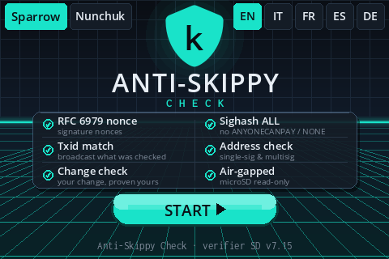 | 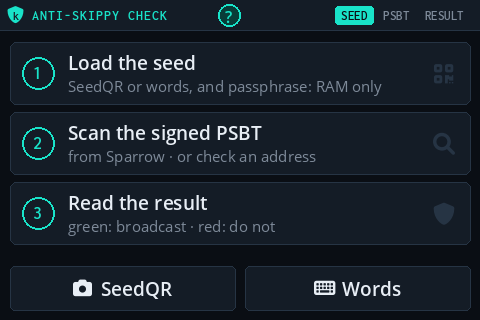 | 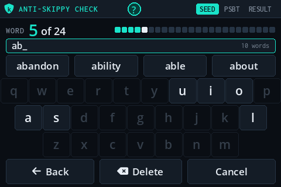 |
| Splash: host and language, RAM only | Three steps | Typing the seed words: only the letters that lead to a BIP-39 word |
| 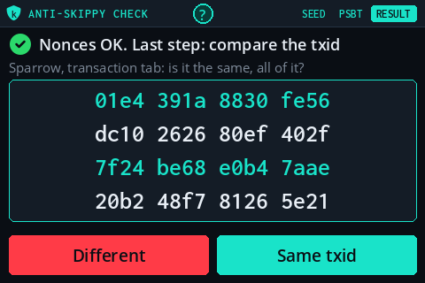 | 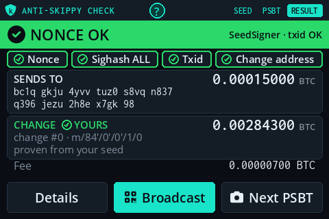 | 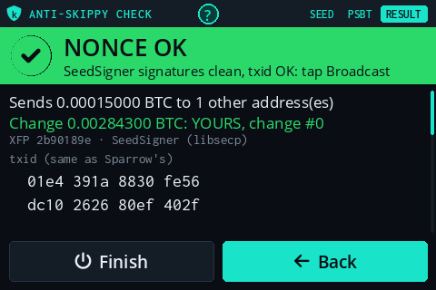 |
| The whole txid, to compare with Sparrow | Result: where the money goes, change proven yours | Details |
| 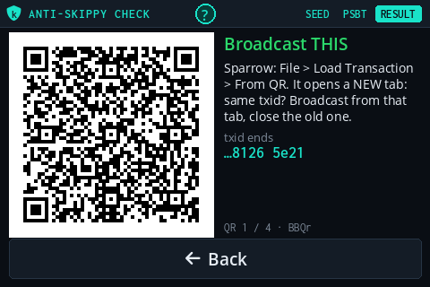 | 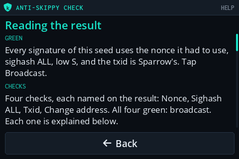 | 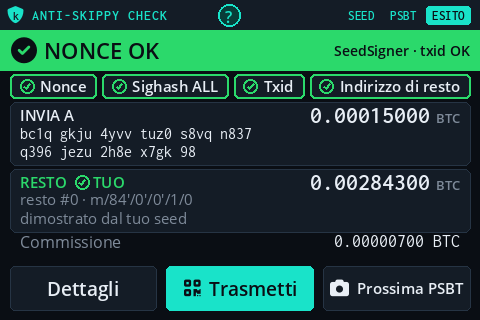 |
| Broadcast THIS: the checked transaction as a QR | "?" help: what to do and why | The same result in Italian |

**Standard SeedSigner** (240×240, joystick and three keys; shown at twice the size). The joystick moves, its center chooses; KEY1 opens the "?" page, KEY2 deletes or zooms, KEY3 goes back. A tab beside each key says what it does on that screen.

| | | | |
|---|---|---|---|
| 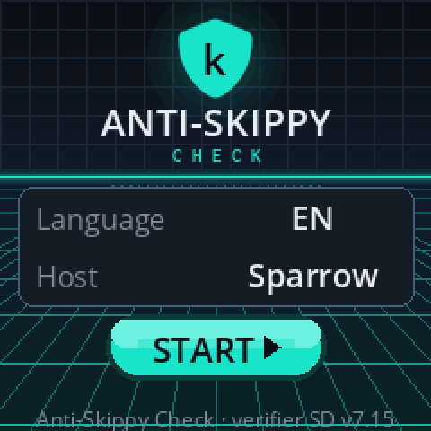 | 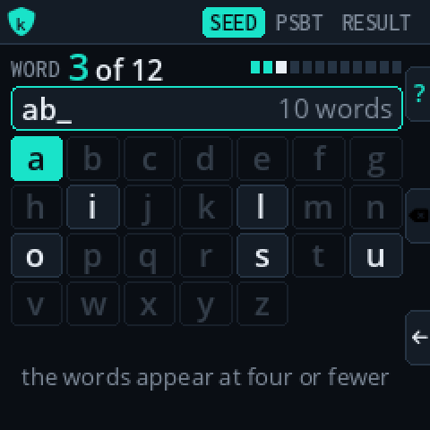 | 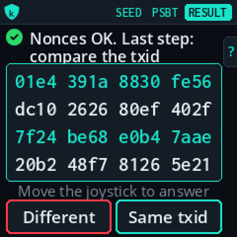 | 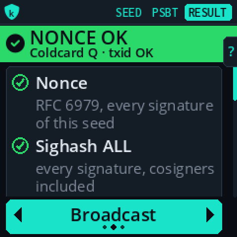 |
| Splash | Seed words, alphabetical | The whole txid; no answer preselected | Result: the four checks |
| 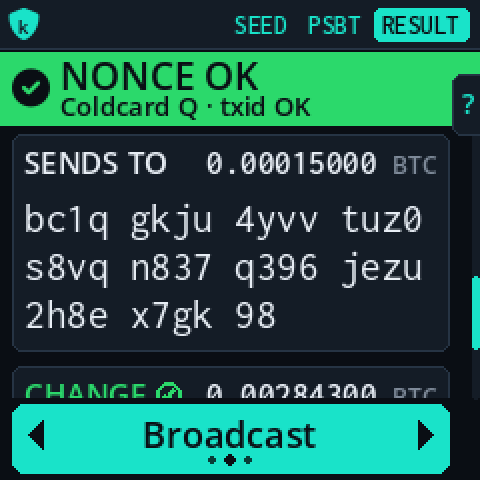 | 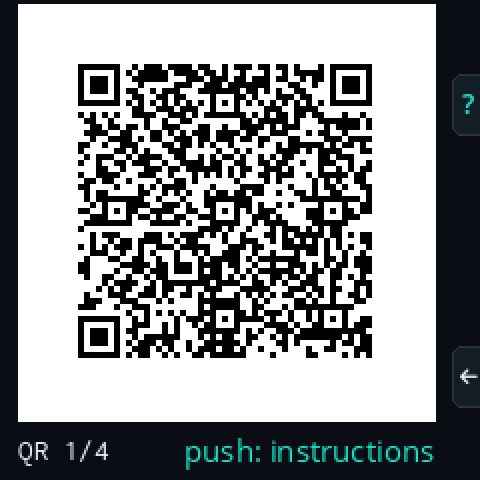 |  | 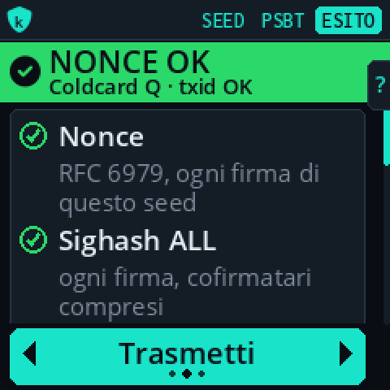 |
| Scrolling down: the whole address | Broadcast THIS | At the end: support the project | The result in Italian |

---

## Limits: read before relying on it

- It only works with signers that use **deterministic RFC 6979 nonces**. Signers that use random nonces, or the interactive *anti-exfil* protocol (Jade, BitBox02), can't be checked this way. Despite the similar name, this tool is not that protocol: it is an after-the-fact check.
- **Taproot (bech32m):** a BIP340 nonce contains random data and can't be recomputed. Taproot inputs are never green (their sighash is still checked). Finalized legacy (non-segwit) inputs are not supported.
- **Multisig:** a cosigner's nonce can't be recomputed without that cosigner's seed. The result is yellow ("THIS SEED: CLEAN") until you load each cosigner's seed in the same session.
- **The verifier needs your seed.** Treat it exactly like a signing device: air-gapped, powered off after use (the OS runs from RAM), never connected to anything.

---

## Status and honesty

- **Experimental software built by one person.** It is tested by the author on his own devices: on the Raspy Max with a Coldcard Q, a Trezor and a SeedSigner as signers and Sparrow as host; on a standard SeedSigner with Sparrow and Nunchuk. **No human third party has audited it.** Start with a test seed and small amounts.
- **Developed with AI assistance** (Anthropic's Claude). Commits carry `Co-Authored-By` lines. The "independent reviews" mentioned in commit messages were separate AI-agent reviews, adversarial tests and mutation testing, not human audits.
- The verifier is `src/nonceverify/`. Its cryptography (secp256k1, RFC 6979, BIP32/39, sighash, PSBT and descriptor parsing) is its own code on the Python standard library. The rules and the order of the steps (what is green, what may be broadcast, what stays red) are in `flow.py`, the same for both devices; each device only draws them (`app.py` for the Raspy Max, `app_classic.py` for the standard SeedSigner). The screen is drawn with Pillow; the display, touch, key and camera drivers are those of the image. `src/main.py` starts the verifier instead of SeedSigner: SeedSigner's signing code is in the tree but never runs, and an import guard keeps it out of the process.
- The version numbers continue the history this code grew in: Seed Max v5 → Anti-Klepto Check v7.0 … v7.14 → Anti-Skippy Check from v7.15 (the same project and the same signing key: only the name changed). One version number is one code: the tag `vX.Y` builds the Raspy Max image, `vX.Y-classic` the standard SeedSigner one, and `git diff vX.Y vX.Y-classic` is a single line (`src/nonceverify/target.py`).

Bug reports are welcome as issues. Report security problems **privately** through [Security › Report a vulnerability](../../security/advisories/new), not in a public issue.

---

## Download and verify

Each [release](../../releases) has two images, one for each device (`…-raspy-max-pi0.img`, `…-seedsigner-pi0.img`), `SHA256SUMS` and `SHA256SUMS.asc`. Take the one for your hardware.

```bash
# 1. get my key from keys.openpgp.org, a source independent of GitHub
gpg --keyserver hkps://keys.openpgp.org --recv-keys 513B35830E4F869EFC6D9534F1A05CB16C898D92
#    (or from GitHub: curl -fsSL https://github.com/Ollen47.gpg | gpg --import)
gpg --fingerprint 513B35830E4F869EFC6D9534F1A05CB16C898D92
#    it must be exactly the fingerprint under "Signing key" below

# 2. verify the signature, then the files
gpg --verify SHA256SUMS.asc SHA256SUMS
sha256sum -c SHA256SUMS --ignore-missing
```

Flash the image to a microSD card with `dd` or GNOME Disks.

### Verify the image

A signature proves who published an image, not what is inside it. [`tools/ssmax_image_audit.py`](tools/ssmax_image_audit.py) proves what is inside: it compares the image with the **official SeedSigner 0.8.7 image**, file by file, and shows that

- the disk layout, the boot partition, the kernel and every file of the operating system are the official ones;
- the only directory that differs is the application, `/opt/src`;
- with `--app-tree`, every file of `/opt/src` is exactly the file of the signed git tag, and every compiled `.pyc` really is the compilation of its `.py`.

It only reads the two image files: no root rights, nothing mounted, nothing installed, no network, Python 3 standard library only.

```bash
# 1. the official SeedSigner 0.8.7 pi0 image: download it from
#    https://github.com/SeedSigner/seedsigner/releases/tag/0.8.7
#    and verify it with SeedSigner's own instructions first
# 2. this repository at the release tag, with its signature checked
git clone https://github.com/perseo-lab/anti-skippy-check.git
git -C anti-skippy-check tag -v v7.15            # standard SeedSigner image: v7.15-classic
# 3. the audit
python3 anti-skippy-check/tools/ssmax_image_audit.py seedsigner_os.0.8.7.pi0.img anti-skippy-check-v7.15-raspy-max-pi0.img \
    --app-tree anti-skippy-check --app-rev v7.15
python3 anti-skippy-check/tools/ssmax_image_audit.py seedsigner_os.0.8.7.pi0.img anti-skippy-check-v7.15-seedsigner-pi0.img \
    --app-tree anti-skippy-check --app-rev v7.15-classic
echo "exit status: $?"
```

Exit status `0` means: operating system identical to SeedSigner 0.8.7, application identical to the tag. Without `--app-tree` the tool never exits with `0` (it exits with `4`, incomplete). If the tag given with `--app-rev` doesn't exist, it stops with an error (`2`). The bytecode check needs CPython 3.12 (any 3.12.x); with another Python, run it in `docker run --rm -v "$PWD":/w -w /w python:3.12 python3 anti-skippy-check/tools/ssmax_image_audit.py ...`.

What the audit does **not** verify: three subset fonts (NotoSans JP/KR/SC), cut at build time by whatever fonttools version is installed and never used by the verifier, and the `egg-info` metadata.

### Run the tests

```bash
git submodule update --init src/seedsigner/resources/seedsigner-translations
python3 -m venv ~/venv/anti-skippy
~/venv/anti-skippy/bin/pip install -r requirements.txt -r tests/requirements-test.txt
~/venv/anti-skippy/bin/pip install --no-deps -e .
~/venv/anti-skippy/bin/python setup.py compile_catalog
~/venv/anti-skippy/bin/python -m pytest tests/test_main.py tests/test_nonceverify*.py   # the verifier
~/venv/anti-skippy/bin/python -m pytest tests                                           # everything
```

`coincurve` (libsecp256k1) is used only by the tests, as an independent reference for signatures and nonces: without it, the verifier's tests are skipped. The full suite includes real-time touch tests and takes several minutes.

### Build from source

The images are built with [SeedSigner OS](https://github.com/SeedSigner/seedsigner-os) (the 0.8.7 checkout), with this repository and the release tag as the app source, one build per device:

```bash
SS_ARGS="--pi0 --app-repo=<this repository> --app-branch=v7.15" docker compose up --force-recreate --build          # Raspy Max
SS_ARGS="--pi0 --app-repo=<this repository> --app-branch=v7.15-classic" docker compose up --force-recreate --build  # standard SeedSigner
```

---

## Signing key

All commits and tags are signed.

```
Ollen_47 <github.mandate556@passmail.net>
513B 3583 0E4F 869E FC6D 9534 F1A0 5CB1 6C89 8D92
```

**Where to check the fingerprint.** This README and `https://github.com/Ollen47.gpg` both come from GitHub: whoever controls this account controls both. [keys.openpgp.org](https://keys.openpgp.org/search?q=513B35830E4F869EFC6D9534F1A05CB16C898D92) is independent: it publishes a key under an email address only after the owner of that address has confirmed it. The two sources must give the same fingerprint.

**Continuity.** The same key signs every commit and tag of this repository and every release since v7.10 (November 2026). If you verified an earlier release, or you have a clone of this repository, the fingerprint must be the same and your clone's history must still match. A different key, or a rewritten history, means something is wrong: do not use the image.

---

## Support the project

Anti-Skippy Check is free and open source. If it is useful to you, a donation is welcome. The device shows the same details as QR codes at the end of a session (and this page's link):

- **Lightning**, a **BOLT12 offer**: scan it with Phoenix, Zeus or another BOLT12 wallet.
- **On-chain**, a **Silent Payments address (BIP 352)**: every payment lands on a fresh Taproot output, so donations can't be linked or counted from outside.

Both are in [`docs/DONATE.txt.asc`](docs/DONATE.txt.asc), **signed with the key above**. Verify the signature before sending: a fork could replace this README, but it can't forge the signature. A BOLT12 offer has no checksum, so copy it from the signed file, never by hand.

```bash
gpg --verify docs/DONATE.txt.asc
```

---

## License and credits

MIT. Original code © 2021 SeedSigner contributors; Seed Max and Anti-Skippy Check © 2026 Ollen_47. See [`LICENSE.md`](LICENSE.md).

- [SeedSigner](https://github.com/SeedSigner/seedsigner): the operating system, drivers and code this is built on.
- XPT2046 read sequence after Paul Stoffregen's XPT2046_Touchscreen (MIT).
- ILI9486 init sequence after the Linux kernel's `drm/tiny/ili9486` driver.
